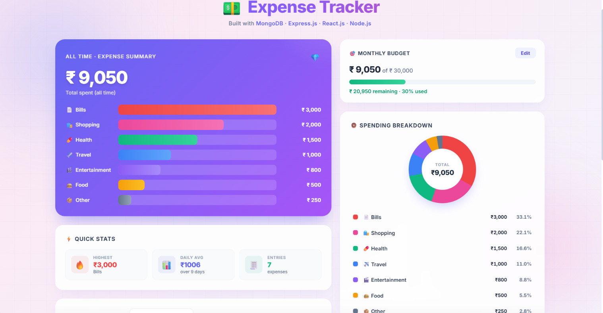
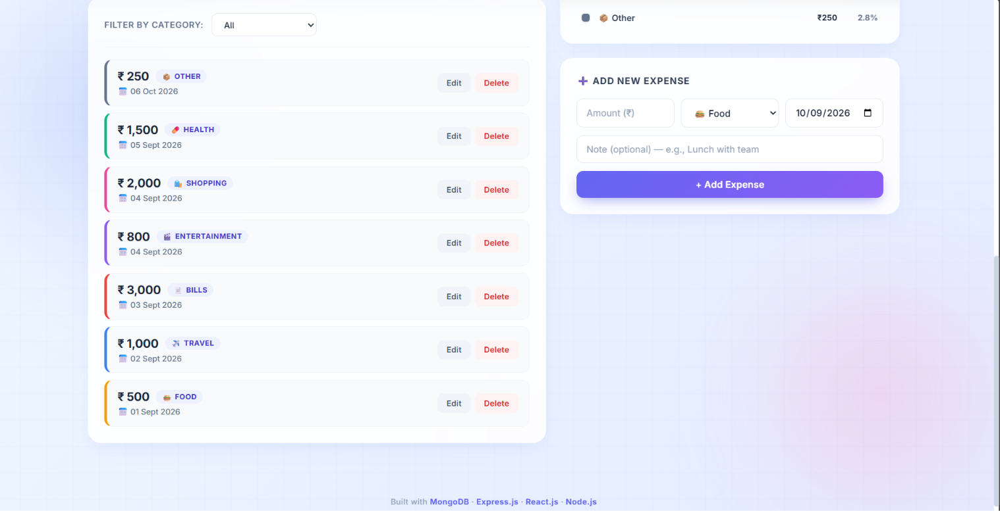

# 💵 MERN Expense Tracker

A full-stack expense tracking application built with the MERN stack — **MongoDB, Express.js, React.js, and Node.js**.

Track daily expenses, filter by category, set a monthly budget, and visualize spending with a live bar chart, a donut chart, and quick stats — all in a clean two-column dashboard.

   

---

## ✨ Features

- **Add expenses** with amount, category, date, and note
- **Edit and delete** any expense inline
- **Filter** expenses by category (Food, Travel, Bills, Shopping, Entertainment, Health, Other)
- **Set a monthly budget** with a color-coded progress bar (green → yellow → red when overspent)
- **Live totals** — hero card shows total spent, updated instantly on any change
- **Bar chart** — category breakdown rendered with pure CSS (no chart library)
- **Donut chart** — spending distribution using CSS `conic-gradient`
- **Quick Stats** — highest expense, daily average, total entries
- **Fully responsive** — two-column dashboard on desktop, stacks on mobile
- **Animated UI** — aurora background, floating gradient orbs, subtle grid overlay
- All data persisted in MongoDB

---

## 🛠 Technologies Used

**Frontend:**
- React.js (Vite)
- Native `fetch()` API — no Axios
- Plain CSS — no Tailwind, no styled-components
- Context-free state management with `useState` / `useEffect`

**Backend:**
- Node.js
- Express.js
- MongoDB with Mongoose ODM
- CORS, dotenv

**Database:**
- MongoDB Atlas (cloud, free tier M0)

---

## 📁 Project Structure

```
mern_expense_tracker/
├── server/
│   ├── models/
│   │   ├── Expense.js
│   │   └── Setting.js
│   ├── routes/
│   │   ├── expenses.js
│   │   └── settings.js
│   ├── .env
│   ├── .gitignore
│   ├── package.json
│   └── server.js
├── client/
│   ├── src/
│   │   ├── components/
│   │   │   ├── BudgetWidget.jsx
│   │   │   ├── CategoryChart.jsx
│   │   │   ├── ExpenseForm.jsx
│   │   │   ├── ExpenseItem.jsx
│   │   │   ├── ExpenseList.jsx
│   │   │   ├── PieChart.jsx
│   │   │   ├── QuickStats.jsx
│   │   │   └── Summary.jsx
│   │   ├── App.jsx
│   │   ├── App.css
│   │   ├── index.css
│   │   └── main.jsx
│   ├── index.html
│   └── package.json
├── .gitignore
└── README.md
```

---

## ⚙️ Setup and Installation

### Prerequisites
- **Node.js** v18 or higher
- **MongoDB** (local install or free [MongoDB Atlas](https://www.mongodb.com/cloud/atlas) cluster)
- **Git**

### 1. Clone the repository
```bash
git clone https://github.com/YOUR_USERNAME/mern-expense-tracker.git
cd mern-expense-tracker
```

### 2. Backend setup
```bash
cd server
npm install
```

Create a `.env` file inside `server/`:
```env
PORT=5000
MONGO_URI=your_mongodb_connection_string
```

> For MongoDB Atlas, use a connection string like:
> `mongodb+srv://<username>:<password>@cluster0.xxxxx.mongodb.net/expensetracker?retryWrites=true&w=majority`
>
> Also whitelist your IP (or `0.0.0.0/0` for development) under **Network Access** in Atlas.

### 3. Frontend setup
```bash
cd ../client
npm install
```

---

## ▶️ How to Run the Application

You need **two terminals** running at the same time.

**Terminal 1 — backend:**
```bash
cd server
npm run dev
```
→ Runs on `http://localhost:5000`

**Terminal 2 — frontend:**
```bash
cd client
npm run dev
```
→ Runs on `http://localhost:5173`

Then open **http://localhost:5173** in your browser.

---

## 🔌 API Endpoints

| Method | Endpoint | Description |
|--------|----------|-------------|
| GET    | `/api/expenses`             | Get all expenses (supports `?category=Food`) |
| GET    | `/api/expenses/summary`     | Aggregate totals — overall + per-category |
| POST   | `/api/expenses`             | Create a new expense |
| PUT    | `/api/expenses/:id`         | Update an expense |
| DELETE | `/api/expenses/:id`         | Delete an expense |
| GET    | `/api/settings/budget`      | Get the current monthly budget |
| PUT    | `/api/settings/budget`      | Update the monthly budget |

---

## 🤖 AI Development Tool

**Tool Used:** Code0

I used **Code0** throughout the development of this project to accelerate coding, understand unfamiliar patterns, and solve problems faster.

## 🧠 AI Development Experience

Below are 5 specific tasks where Code0 was instrumental during development:

### 1. MongoDB Aggregation Pipeline
I needed a `/summary` endpoint that groups expenses by category and returns total amounts. Code0 generated the initial aggregation pipeline with `$group` and `$sort` stages, and explained how the `_id` field controls the group key. I then adapted the response shape to match what the frontend expects.

### 2. REST API Creation
Code0 scaffolded the entire Express router (`routes/expenses.js`) with all five CRUD endpoints, each wrapped in consistent `try/catch` error handling. It also suggested adding the Mongoose `enum` validator on the `category` field so only valid categories could be saved — a safeguard I hadn't thought of.

### 3. Component Development
For the frontend, Code0 generated the initial structure of `ExpenseForm`, `ExpenseItem`, `ExpenseList`, and `CategoryChart`. I used its suggestions for prop names and state shape, then customized the CSS to match my design. It helped me understand how to keep child components presentational by lifting state up to `App.jsx`.

### 4. CSS-Only Donut Chart
I wanted to avoid using any charting library. Code0 explained how to build a donut chart using `conic-gradient` with cumulative percentage stops. I integrated this into `PieChart.jsx`, calculated the gradient stops dynamically from the API data, and paired it with a clean legend showing name → amount → percentage.

### 5. Debugging
When `findByIdAndUpdate` silently ignored invalid categories during testing, Code0 identified that I was missing `runValidators: true`. It also helped me solve an early `querySrv ECONNREFUSED` error by suggesting an explicit DNS override in `server.js` (`dns.setServers(['8.8.8.8'])`) — a Node.js v24 regression issue on Windows.

---

## 📸 Screenshots

### Main Dashboard


### Analytics & Charts

## 📄 License

This project is open source and available under the MIT License.